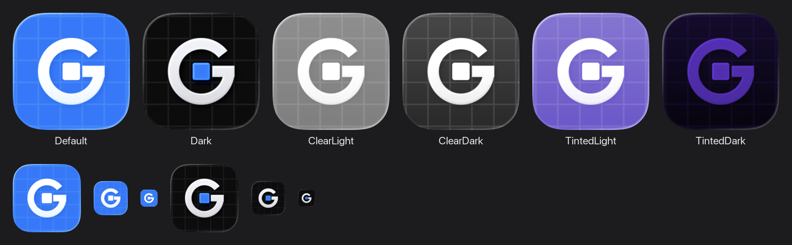

# TableGrip: app icon



Icon là chữ **G** ôm lấy một ô bảng: gạch ngang của chữ G chạy vào đúng ô ở giữa lưới nền, và ô đó được nâng lên như đang được "nắm". Hình ghép từ hai phần của tên app: *Grip* (chữ G nắm lấy) và *Table* (ô bảng).

Icon được dựng bằng Icon Composer (Liquid Glass, macOS 26), với ba tầng xếp từ trước ra sau:

| Group | Glass | Default | Dark |
| --- | --- | --- | --- |
| **Cell**: ô bảng | bật, có specular; bóng đổ cùng màu với ô (*layer-color*) | trắng | xanh `#0A7AFF` |
| **Grip**: chữ G | bật, có specular; translucency 20% | trắng | trắng ngà `#EBEDF2` |
| **Grid**: lưới nền | tắt | trắng, độ mờ 11% | trắng, độ mờ 7% |
| Nền | | `#0A7AFF` | `#0C0C0D` |

Ở các appearance **Clear** và **Tinted**, hệ thống tự chuyển màu.

## File

```
TableGrip.icon/          # file nguồn: mở bằng Icon Composer
renders/*.png            # Default, Dark, ClearLight, ClearDark, TintedLight, TintedDark (1024 px, render bằng ictool)
appearances.png          # ảnh tổng hợp ở trên
tools/build_icon.py      # sinh TableGrip.icon và renders/ từ hình học trong code
tools/export_app_icon.py # xuất icon ra các file mà bản build dùng (app/src/icons/)
```

## Sửa icon

Cả hai script đều cần Xcode 26 (dùng `actool` và `ictool` của Icon Composer).

1. Sửa hình hoặc màu trong `tools/build_icon.py`, rồi chạy:
   ```bash
   python3 assets/branding/tools/build_icon.py
   ```
   Nếu tinh chỉnh trực tiếp trong Icon Composer thì bỏ qua bước này, vì script sẽ ghi đè các chỉnh sửa đó.
2. Xuất lại các file mà app dùng:
   ```bash
   python3 assets/branding/tools/export_app_icon.py
   ```

Các file xuất ra được commit sẵn, nên CI build không cần Xcode 26:

| File | Dùng cho |
| --- | --- |
| `app/src/icons/Assets.car` | macOS 26: icon Liquid Glass, được tìm qua `CFBundleIconName`. Bước `createDistributable` copy file này vào `Contents/Resources/` trước khi ký lại app |
| `app/src/icons/TableGrip.icns` | macOS 12–15: `macOS { iconFile }` |
| `app/src/icons/TableGrip.ico` | Windows (MSI, file exe, shortcut): `windows { iconFile }`, gồm các cỡ 16–256 |
| `app/src/icons/TableGrip.png` | Linux (deb): `linux { iconFile }`, 512 px |
| `app/src/main/resources/icon/TableGrip.png` | icon của cửa sổ, hiện trên taskbar Windows và Linux (`ui/AppIcon.kt`) |
