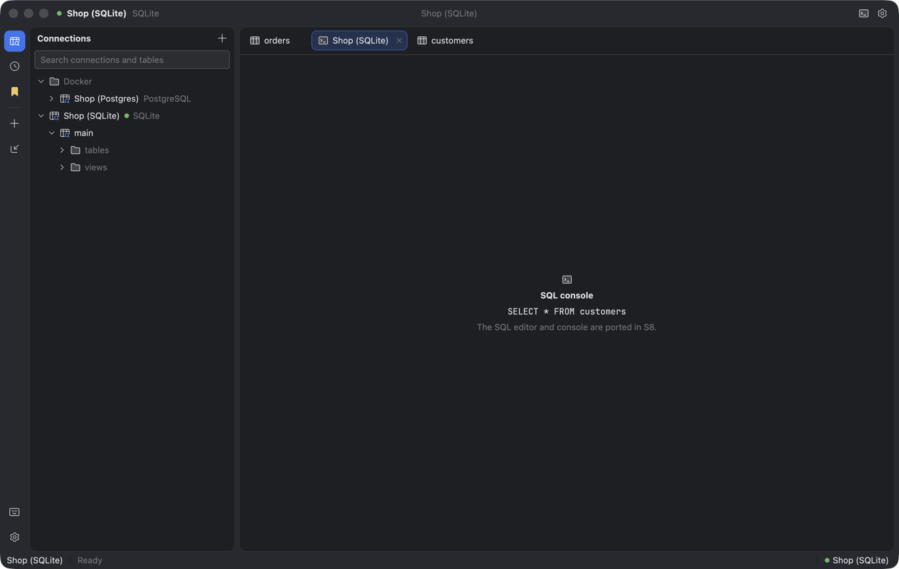
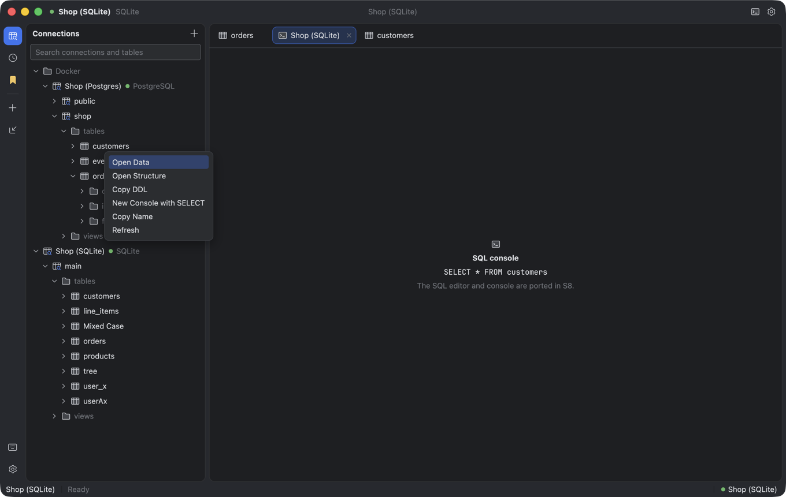
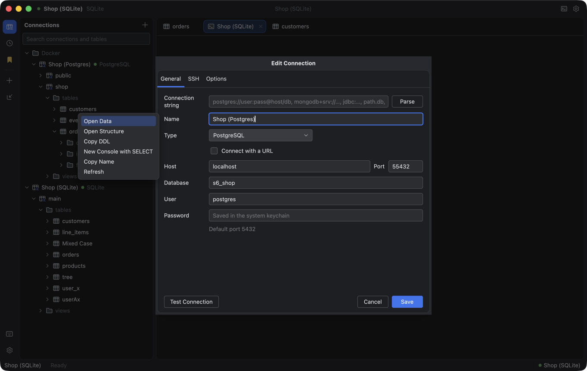

# Migrate TableGrip sang Rust: kế hoạch toàn phần

Kế hoạch UI kit: [rust-ui-kit.md](rust-ui-kit.md). Tài liệu này đi tiếp từ chỗ UI kit dừng: port toàn bộ core, driver,
màn hình nghiệp vụ, đóng gói và phát hành, rồi gỡ hẳn mã Kotlin.

## Hiện trạng (nhánh `feat/rust-ui-kit-phase-0`, 10/11/2026)

| Phần | Kotlin | Rust | Ghi chú |
|---|---|---|---|
| UI kit (Jewel thay thế) | `app/ui`, `app/ui/theme` (~3,1k dòng) | 7 crate, ~20,6k dòng, phase 0–6 L+R xong | So ảnh 6 theme đạt ở M0 (336/336, 11 khác biệt đã duyệt); CI 3 OS chờ push |
| Core (`core/`) | 167 file, ~20k dòng | — | Chưa bắt đầu |
| Màn hình (`app/`) | 267 file, ~38k dòng | — | Chưa bắt đầu |
| Engine Redis / MongoDB | `engines/*` ~0,8k dòng | — | Chưa bắt đầu |
| Test | 187 file test Kotlin | test riêng UI kit | Test core/app chưa port |
| Đóng gói, cập nhật | Compose Desktop + jpackage, Sparkle (mac), WinSparkle (Win) | — | `release.yml` vẫn build bằng Gradle |

Kịch bản conformance và golden dùng runner Kotlin làm chuẩn đối chiếu cho đến M9.

## Nguyên tắc

1. **Tương thích dữ liệu người dùng là bắt buộc.** Bản Rust đọc nguyên `~/.tablegrip` (hoặc `tablegrip.home`): kết
   nối, settings, lịch sử, chat, workspace, backup schedule; và đọc đúng mục keychain (service/account) mà
   `SecretStore` đang ghi. Có test fixture lấy từ file bản Kotlin thật ghi ra.
2. **Kotlin là chuẩn đối chiếu đến phút cuối.** Logic thuần (lexer, splitter, formatter, dialect, filter, completion,
   chart suggest, type inference…) được port kèm *golden test*: chạy bản Kotlin trên cùng bộ input, ghi output ra JSON
   trong `conformance/core/`, bản Rust phải khớp. Golden được đóng băng trước khi xoá Kotlin.
3. **Tách logic khỏi GPUI** như UI kit: mỗi màn hình có crate/module state thuần Rust, test headless; phần vẽ mỏng.
4. **Mỗi PR một mảng nhỏ (≤ ~600 dòng)** kèm test, giống quy ước UI kit.
5. Bản Kotlin không thêm tính năng mới trong thời gian migrate (chỉ sửa lỗi nghiêm trọng).

## Kiến trúc đích

Workspace Cargo nằm ở gốc repo (đã làm ở M0): `crates/`, `conformance/`, `resources/` (theme, icon dùng chung).

```
crates/
  tg-theme, tg-text, tg-ui-logic, tg-ui, tg-gallery, tg-imgdiff   (đã có)
  tg-core        paths, settings, connection config/store, secret store (keyring), ssh tunnel (russh),
                 history, queries, session, activity, backup, theme prefs
  tg-sql         lexer, splitter, classifier, formatter, keywords, parameters, dialect, filter/projection,
                 DDL script, schema snapshot/diff, completion (SQL + document)
  tg-driver      trait RelationalConnection / KeyValueStore / DocumentStore, QueryResult, QuerySession, lỗi,
                 introspection model; mỗi engine sau một feature flag:
                   postgres (tokio-postgres + deadpool), mysql/mariadb (mysql_async), sqlite (rusqlite, bundled),
                   mssql (tiberius), clickhouse (HTTP, clickhouse crate), duckdb (duckdb crate, bundled),
                   redis (redis-rs), mongodb (mongodb crate), etcd (reqwest, v3 JSON API)
  tg-data        datafile (CSV/JSON/XLSX working copy + sync), importer + type inference, export/clipboard,
                 connection import (DBeaver, .env, IDE data sources, pgpass, plist, ssh hosts), test data
  tg-agent       agent registry, chat store, mentions, CLI adapter (spawn + decoder), provider adapter (SSE),
                 assist (SQL fix, chart assist, schema digest)
  tg-chart       chart spec/query/data/suggest, column profiler
  tg-app-logic   state của từng màn hình (grid model, edit history, filter builder, editor actions…)
  tg-app         binary GPUI: shell, explorer, các tab, dialog, settings, updater
```

Runtime: Tokio cho I/O, GPUI executor cho UI; cầu nối bằng channel. Huỷ query qua `CancellationToken` + cancel phía
server (pg cancel request, `KILL QUERY`, …), thay cho huỷ coroutine.

## Quyết định cần chốt trước M1

| # | Câu hỏi | Đề xuất |
|---|---|---|
| D1 | H2, HSQLDB, Derby và "Generic JDBC" chỉ có driver Java | **Bỏ** ở bản Rust 1.0; ghi rõ trong changelog. Phương án dự phòng: sidecar JVM nói JSON-RPC, làm sau nếu có người dùng yêu cầu |
| D2 | Cơ chế tải driver (`DriverLibrary`, lock file, BYO jar) | **Bỏ**: driver Rust biên dịch sẵn vào app. Hết vấn đề giấy phép Connector/J (GPL) |
| D3 | Cập nhật tự động | Giữ định dạng appcast + chữ ký Ed25519 hiện có. macOS: Sparkle.framework qua objc; Windows: WinSparkle qua FFI (DLL đã dùng). Linux: chỉ thông báo |
| D4 | Đóng gói | `cargo-packager`: `.app`/`.dmg` (ký + notarize), MSI (WiX), AppImage + `.deb` |
| D5 | Vị trí workspace Rust | **Đã chốt (M0):** `Cargo.toml` ở gốc repo, `crates/` ở gốc |

## Các mốc

Thời gian là ước lượng cho một người; nhiều mảng chạy song song được theo kiểu wave như UI kit.

Cách chia M1–M9 thành session, kèm prompt dán sẵn cho từng session: [sessions.md](rust-migration/sessions.md).

### M0 — Khép UI kit và dựng khung (1 tuần)
- Chạy Wave D của UI kit: so ảnh 6 theme, CI `ui-kit.yml` xanh trên macOS/Windows/Linux.
- Chuyển theme JSON sang `resources/themes/` dùng chung (Kotlin đọc qua `sourceSets`, Rust `include_str!` đường mới).
- Dọn 9 git worktree cũ trong `.claude/worktrees` (đã merge).
- Tạo crate rỗng theo kiến trúc đích, CI `cargo test --workspace` + `clippy` 3 OS.
- Viết harness golden phía Kotlin (`core/src/test/.../golden`) ghi JSON vào `conformance/core/`.

### M1 — Core thuần, không I/O (2–3 tuần)
`tg-sql` và phần thuần của `tg-chart`, `tg-data`: lexer, splitter, classifier, formatter, keywords, parameters,
`SqlDialect` (sinh SQL cho từng engine), filter/projection, DDL, schema diff, completion, type inference, chart
suggest/profiler, value formats. **Xong khi:** golden khớp 100% cho mọi engine.

### M2 — Lưu trữ và bảo mật (1–2 tuần)
`tg-core`: `TableGripPaths`, settings, `ConnectionStore`, `ConnectionString` (parse URL), `SecretStore` (crate
`keyring`, cùng service/account), history, saved queries, chat store, workspace, backup schedule, SSH tunnel (russh:
key, agent, password, known_hosts). **Xong khi:** đọc/ghi được bộ fixture `~/.tablegrip` do Kotlin tạo, round-trip
không đổi byte ngoài phần cố ý.

### M3 — Driver quan hệ (3–4 tuần)
`tg-driver` cho PostgreSQL, MySQL, MariaDB, SQLite, SQL Server, ClickHouse, DuckDB: pool, `QuerySession` riêng cho
console, `fetchPage`, export stream, introspection (`Introspector`, `StructureReader`), sample values, apply changes,
DDL, cancel, timeout, activity monitor, server identity, đọc binary/text. Port `RelationalContract` thành bộ test
chung chạy với mọi engine; integration test bằng Docker giống `ServerEnginesIntegrationTest`.
**Xong khi:** contract pass cho cả 7 engine, kết quả introspection khớp golden Kotlin trên schema `structure-it/*.sql`.

### M4 — Driver phi quan hệ (1–2 tuần)
Redis (key browser, scan, kiểu dữ liệu, command console), MongoDB (document store, query builder), etcd. Port test
của `engines/*` và `driver/etcd`.

### M5 — Data, agent, backup (2–3 tuần)
- `tg-data`: CSV/JSON/XLSX (csv, calamine, rust_xlsxwriter), data-file working copy + sync, import wizard backend,
  connection importers, test data generator, result formats/clipboard.
- `tg-agent`: CLI agent (spawn, shell env, decode output, model list), provider (HTTP streaming), mentions, assist.
- Backup/restore và scheduler.

### M6 — Màn hình lõi (5–7 tuần, phần khó nhất)
Theo thứ tự để sớm có bản dùng được nội bộ:
1. Shell `MainScreen`, kết nối (danh sách, dialog, test connection), explorer tree, status bar, workspace tabs,
   khôi phục workspace.
2. **Data grid** (`grid/*`, ~4,9k dòng): ảo hoá hai chiều, chọn ô/vùng, sửa ô, cell editors, paste, edit history,
   record editor, JSON tree, value panel, selection stats. Mục tiêu 1 triệu hàng mượt.
3. **SQL editor + console** (`console/*`): dựa trên `tg-text`, tô màu cú pháp, completion, chạy nhiều câu, kết quả
   nhiều tab, fix view, chart view.
4. Table view: filter builder, select builder, structure view, chỉnh sửa và commit.

### M7 — Màn hình còn lại (3–4 tuần)
Document browser + query builder, key browser + command console, schema tools (ER diagram + xuất ảnh, schema
compare, table designer, import dialog/wizard, test data dialog), chart, agent panel (markdown, model picker, mention,
history), settings (mọi trang), search, tools, files, backup UI, activity, shortcuts dialog, About.

### M8 — Đóng gói, cập nhật, phát hành (1–2 tuần)
`cargo-packager` cho 3 OS, ký/notarize macOS, Azure signing cho Windows, appcast (giữ `scripts/appcast.py`),
updater theo D3, `release.yml` chuyển sang cargo. Phát hành **beta Rust** song song với bản Kotlin cùng kênh beta để
người dùng thử, dữ liệu dùng chung nhờ M2.

### M9 — Parity và gỡ Kotlin
**Cổng vào (tất cả phải đúng):**
- Bảng parity theo từng file Kotlin trong `app/` và `core/` đều có dòng "đã port" hoặc "bỏ có chủ đích".
- Mọi golden và kịch bản conformance đã đóng băng, CI Rust xanh 3 OS.
- Một bản beta Rust đã phát hành và chạy ổn ít nhất 2 tuần.

**Cleanup (PR riêng, chỉ xoá):**
- Xoá `app/`, `core/`, `engines/`, `build.gradle.kts`, `settings.gradle.kts`, `gradle/`, `gradlew*`,
  `gradle.properties`, `build/`, `build-dev/`.
- Xoá runner conformance Kotlin; giữ `conformance/` (scenarios, golden, reference) làm fixture đóng băng.
- Sửa `scripts/run.sh`, `run.cmd`, `test-update.sh`; workflow `release*.yml`, `appcast.yml`, đổi `ui-kit.yml` thành
  CI chính.
- Cập nhật `README.md`, `CONTRIBUTING.md`, `docs/development.md`, `docs/guide.md`, `NOTICE` (bỏ phần Jewel/JDBC, thêm
  giấy phép crate), `.gitignore`.
- `rg -g '*.kt' -g '*.kts' --files` phải rỗng; `rg 'gradle|Jewel|Compose'` chỉ còn trong CHANGELOG.

## Tổng ước lượng

M0–M8: khoảng 20–28 tuần cho một người, rút xuống còn khoảng một nửa nếu chạy song song theo wave (M1/M2 song song;
M3/M4/M5 song song; trong M6–M7 mỗi màn hình một session sau khi shell xong).

## Nhật ký

### M0 (10/11/2026)

- Xoá 9 git worktree cũ của UI kit trong `.claude/worktrees`. Mọi commit của chúng đã có trên nhánh này; các branch
  `claude/ui-kit-*` vẫn giữ nguyên.
- Workspace Cargo lên gốc repo: `Cargo.toml`, `Cargo.lock`, `rust-toolchain.toml`, `crates/`, `conformance/`;
  `scripts/imgdiff.sh` và `scripts/extract-icons.py` chuyển từ `ui-kit/scripts`.
- Theme JSON và icon riêng của app chuyển sang `resources/themes`, `resources/icons`. Gradle thêm `resources/` vào
  resource của `:app` nên jar vẫn có `/themes/*.json` và `/icons/*.svg` như trước.
- Khung crate rỗng: `tg-core`, `tg-sql`, `tg-driver`, `tg-data`, `tg-agent`, `tg-chart`, `tg-app-logic`, `tg-app`.
- CI: `ui-kit.yml` đổi thành `rust.yml`, chạy ở gốc repo; job Kotlin chạy thêm `CoreGoldenTest`.
- Golden cho core: `CoreGoldenTest` đọc `conformance/core/inputs/*.json` và ghi `conformance/core/golden/*.json`
  (`-Pconformance.record=true`). Hiện có ba subject: `sql-lexer`, `sql-splitter`, `sql-classifier`. Phía Rust,
  `crates/tg-sql/tests/golden.rs` đã kiểm tra golden phủ đủ input và in ra các subject còn pending. M1 thêm một nhánh
  `run` cho mỗi subject port xong.
- Wave D: so ảnh cả 6 họ theme (12 biến thể), 336/336 specimen đạt. 11 khác biệt (10 ở Contrast do khử răng cưa, 1 ở
  thanh cuộn Catppuccin Frappé) được ghi vào `conformance/approved-image-diffs.json`, mỗi mục có trần riêng và lý do;
  `tg-imgdiff` có thêm `--approved`.
- Còn lại: CI `rust.yml` xanh trên Windows và Linux, chỉ xác nhận được sau khi push.

### S1 (10/11/2026)

Nhánh `rust/core-pure`. Xong cả 6 bước của M1: tg-sql (lexer → completion), tg-chart và tg-data (phần thuần). Mọi subject
trong `conformance/core/inputs` (29 subject) khớp golden Kotlin trên Rust, không còn subject pending.

- **Model dùng chung ở `tg_sql::model`** (DatabaseType, Namespace, TableRef, ColumnInfo, TableDetails, constraint,
  trigger, `jdbc_types`). Lý do: dialect, filter, DDL, schema diff và completion đều cần, còn tg-sql không phụ thuộc
  crate TableGrip nào. Vì vậy tg-core (S2) và tg-driver (S3) dùng được mà không phụ thuộc lẫn nhau. DatabaseType
  serialize theo `id` như Kotlin. Danh sách DriverId và defaultProperties của JDBC bị bỏ khỏi descriptor (D2), để
  tg-driver tự giữ theo engine. H2/HSQLDB/Derby/OtherJdbc vẫn còn trong danh sách để profile cũ vẫn đọc được (D1).
- `SqlDialect` là enum gồm 8 dialect. Phần bind JDBC chuyển cho driver. `list_namespaces` nhận tên schema/catalog mà
  driver đã đọc.
- Offset tính theo byte. Runner golden đổi sang UTF-16. Khác Kotlin ở ký tự ngoài BMP nằm ngoài chuỗi/comment
  (`tg_sql::kt`).
- FilterCompiler: giờ hiện tại và múi giờ là tham số, ngày đầu tuần là một setting (mặc định thứ Hai, Kotlin lấy theo
  locale).
- Harness golden dùng chung: `crates/tg-sql/tests/support/harness.rs` (mỗi crate include bằng `#[path]`). Subject
  `chart-*` thuộc về tg-chart, `data-*` thuộc về tg-data. Subject được ghi golden nhưng chưa có runner thì test fail.
- Float trong golden: ER layout dùng bit pattern. Golden chart đọc double bằng `serde_json/float_roundtrip` (dev-dep
  của tg-chart).
- **Golden (số ca)**: tg-chart: chart-values 118, chart-profile 25, chart-suggest 50, chart-spec 53, chart-data 61,
  chart-lttb 13, chart-query 31 (mỗi ca chạy trên mọi dialect). tg-data: data-inference 245, data-clipboard 57,
  data-formats 86. Input dùng `"gen": {"count", "cells": ["{i}", "{i%k}"]}` để sinh nhiều dòng (downsample, giới hạn
  scatter, cap distinct) mà không phình file; chart-data có `"summary": true` chỉ in số điểm, điểm đầu/cuối và tổng y.
  Input tránh series có tổng bằng nhau (Kotlin phá hòa theo thứ tự hash).
- **tg-chart**: các test Kotlin chạy SQLite thật (ChartQueryTest) không thành golden được; phần SQL sinh ra đã được
  golden phủ cho cả 8 dialect, còn việc chạy trên SQLite thuộc contract test của driver (S3). Đọc số từ text nay nhận
  cả hex float của Java (`0x1p3`), lệch này lộ ra nhờ golden. Kiểm tra checkpoint (đọc dài dừng theo callback) là test
  Rust riêng, `crates/tg-chart/tests/checkpoint.rs`.
- **tg-data** (chỉ phần thuần, chưa có reader/writer file, đó là S5):
  - `TypeInference` port nguyên; `is_json` mô phỏng `Json.parseToJsonElement` của kotlinx.serialization 1.11 (module
    `kotlinx_json`), vì nó rộng hơn JSON thật: giá trị không có nháy được đọc như chuỗi ký tự thô (`[abc]`, `{"a":1;}`,
    `[~]` đều hợp lệ), và sau `]` còn giá trị thì vẫn nuốt vào cùng mảng (`[1,2]x]`). Độ sâu lồng nhau tối đa 2000 (Kotlin
    tràn stack ở mảng, còn object chuyển sang đệ quy tường minh), nên khác Kotlin ở cỡ đó.
  - `ResultFormats`/`ResultWriter` ghi qua `io::Write`. Cột số khi xuất JSON không in lại đúng chuỗi gốc mà theo cách
    kotlinx in `BigDecimal`: đọc `toString()` thành long, rồi unsigned long, rồi double (`1.50` thành `1.5`, `1e3` thành
    `1000.0`, `1e400` làm lệnh ghi lỗi). Vì thế `tg_sql::Decimal::to_java_string` (`BigDecimal.toString`) và
    `Double.toString` kiểu Java (JDK 19+, gồm ca 4.9E-324) được thêm. `ResultColumn` tạm định nghĩa trong tg-data
    (giống `ChartColumn` của tg-chart); S3 nên gộp cả hai vào kiểu kết quả của tg-driver.
  - `ResultFormats::format` trả `io::Result<String>` vì ca `1e400` ở trên; golden ghi `"error"` cho ca đó.
- Gradle: golden test dùng build cache nên khi đổi file input mà không đổi code, chạy
  `./gradlew :core:cleanTest :core:test --tests '*CoreGoldenTest*' -Pconformance.record=true --no-build-cache`.

Còn dở / lưu ý cho session sau:
- Chưa làm: reader/writer CSV, JSON, XLSX, ImportReader, working copy của file dữ liệu (S5).
- Số Unicode ngoài ASCII trong `BigDecimal` (chữ số Ả Rập...) Java nhận, `Decimal::parse` thì không. Không có trong golden.

### S2 (10/11/2026)

Nhánh `rust/storage` (cắt từ `rust/core-pure` ở `bc0e3b8`, nên dùng được `tg_sql::model`). SshTunnel làm song song ở
nhánh `rust/storage-ssh` rồi đã merge vào `rust/storage`. ChatStore để S5. Đã thử merge thêm phần cuối của S1
(`rust/core-pure`): chỉ xung đột ở nhật ký, toàn workspace vẫn xanh với `preserve_order`.

Xong, trong `crates/tg-core`, mỗi mô-đun mirror một package Kotlin:
- `paths`: `TableGripPaths` là struct giữ `home`. `from_env()` đọc `TABLEGRIP_HOME` (thay `tablegrip.home`), `new(path)` cho
  test, nên test không chạm `~/.tablegrip` thật.
- `settings`, `theme`, `backup` (chỉ `BackupSchedule`: lịch nằm trong settings.json, Kotlin không lưu gì thêm).
- `connection::{config, store, string, files, ai_access, secret}`.
- `history`, `queries`, `session`, `activity` (xem "Khác kế hoạch").
- `json`: phần tương thích kotlinx. `omit_defaults!` ghi đúng thứ tự khai báo và bỏ field bằng mặc định (kotlinx
  `encodeDefaults = false`, mặc định của `Json {}`); `strip_lenient` đọc comment và dấu phẩy thừa (settings và theme);
  `to_pretty(indent)` (kotlinx mặc định thụt 4 dấu cách, settings/theme dùng 2). `serde_json` bật `preserve_order` để
  profile mà bản này không hiểu (engine của bản mới hơn) được ghi lại nguyên thứ tự key, như `ConnectionStore.write`.
- Dependency mới (đều MIT/Apache, ghim ở `[workspace.dependencies]`): `keyring` 3.6.3 (chỉ macOS/Windows), `indexmap`
  2.14.2 (map giữ thứ tự như `LinkedHashMap`), `tempfile` 3.27.0 (dev). Không cần sửa `NOTICE`.

**Fixture round-trip: JSON tương đương và byte giống hệt** trên cả 7 file (connections, settings, theme, history, session,
3 file queries). `StorageFixtureTest` (Kotlin) sinh `conformance/core/fixtures/home/` bằng chính các store Kotlin
(`-Pconformance.record=true`; không có cờ thì test so sánh và fail nếu format đổi): 33 profile (mọi DatabaseType, cộng SSH, URL thô, unicode), SSH
dạng key, agent (key mặc định) và password, profile "từ tương lai" (type `QuantumDB`) để kiểm tra giữ nguyên profile lạ,
settings không mặc định ở mọi field, theme file, history có unicode/xuống dòng, queries trong thư mục, session có
window/split. `crates/tg-core/tests/fixture.rs` đọc fixture, ghi lại qua store Rust vào thư mục tạm rồi so.

Test Rust đã port (đều pass; 57 test trong tg-core, 2 test keychain ignore):
- `tests/connection.rs`: ConnectionStoreTest (3), AiAccessTest (2), DatabaseFilesTest (2 phần đầu), cộng kiểm tra giữ
  profile lạ, thứ tự và field mặc định, `effective_driver`.
- `tests/connection_string.rs`: ConnectionStringTest (12) và phần "pasted paths" của DatabaseFilesTest, cộng test redis TLS và
  percent-decoding.
- `tests/settings.rs`: SettingsStoreTest (6), phần settings của StorageTest, ThemeFilesTest (3), BackupScheduleTest (2).
- `tests/storage.rs`: phần history của StorageTest, QueryLibraryTest (4), SessionStoreTest (2), ActivityTest.support, cộng
  `running_for`.
- `tests/fixture.rs`: round-trip fixture.

Khác kế hoạch / khác Kotlin:
- **Sửa một lỗi Kotlin (`core/src/main`, commit `fix(core): a plain redis:// URL no longer turns on TLS`)**:
  `redisUri` kiểm tra `scheme.endsWith("s")` để nhận `rediss://`, nhưng "redis" cũng kết thúc bằng "s", nên mọi URL
  `redis://` dán vào đều ra `ssl=true`. Đã sửa thành `rediss`/`valkeys` và thêm test; Rust làm theo hành vi đúng.
- `Activity.kt` không có phần lưu trữ nào (chỉ monitor đọc từ DB). Đã port kiểu dữ liệu, `SessionActivity::running_for` và
  `ActivitySupport::of` (pure, có test); phần query theo engine để S3. Thời điểm dùng `chrono::DateTime<Utc>` thay `Instant`.
  `Backup.kt` chỉ có `BackupSchedule` là phần lưu trữ; lệnh `pg_dump`... thuộc M5.
- Lỗi parse settings.json: thông điệp lấy từ serde, không trùng chữ với kotlinx (chỉ dùng để hiển thị). Lỗi đọc file (I/O)
  cũng được coi là `load_error` để không ghi đè, trong khi Kotlin ném exception.
- Số thực trong session (`window`, `sidebarSplit`...) dùng `f32` như Kotlin `Float`; serde_json in giống Java với dải giá trị
  thường dùng (không có dạng mũ).
- `ConnectionStore::load/save` trả `Result` (Kotlin ném exception khi file không phải mảng JSON hay JSON hỏng).

Kiểu model tạm định nghĩa ở tg-core, **cần gộp về sau** (tg-sql do S1 sở hữu nên không đụng):
- `connection::DriverId` (14 giá trị, serialize theo tên) và `DriverId::for_type(&DatabaseType)` (bảng `drivers` của từng
  engine, suy từ family và id). Profile vẫn lưu field `driver`, nên cần giữ để đọc/ghi. Gợi ý: chuyển sang tg-driver (S3) khi
  tg-driver có enum driver riêng; tg-core giữ một bản tối giản để serialize.
- `connection::SshConfig` / `SshAuth` là kiểu lưu trong profile; `ssh::SshTunnelSpec` / `ssh::SshAuth` là đầu vào của
  tunnel (có thêm secret và `Agent`). `SshTunnelSpec::from_config(&SshConfig, secret, paths.known_hosts())` nối hai bên.
- `connection::ConnectionConfig`, `Environment`, `DataFileOptions`, `AiAccess` ở tg-core đúng chỗ (Kotlin cũng ở package
  `connection`), nhưng S3 sẽ import từ `tg_core::connection`; không cần chuyển.

Keychain (SecretStore):
- Theo mã nguồn java-keyring 1.0.4: macOS = generic password (service `TableGrip`, account = connection id hoặc `<id>:ssh`,
  UTF-8); Windows = credential generic có target `TableGrip|<key>`, UserName = key, blob UTF-16LE; Linux = Secret Service với
  attribute `service`/`account`, label `service|account`. `keyring` đọc/ghi hai kiểu đầu đúng như vậy (Windows dùng
  `Entry::new_with_target("TableGrip|<key>", ...)` vì mặc định của crate là `<user>.<service>`).
- **Đã kiểm tay trên macOS (10/11/2026): đạt.** `KeychainProbeTest` (Kotlin, chỉ chạy khi có
  `-Pkeychain.probe=set|delete`) ghi item `service=TableGrip account=tablegrip-s2-probe`; test Rust
  `reads_the_item_java_keyring_wrote` đọc lại đúng giá trị, và `writes_an_item_java_keyring_can_read_and_removes_it`
  ghi rồi xoá được một item. Cả hai là `#[ignore]` vì macOS hỏi quyền truy cập (lần đầu agent chạy thì treo chờ hộp
  thoại). Cách chạy lại: `./gradlew :core:test --tests '*KeychainProbeTest*' -Pkeychain.probe=set`, rồi
  `cargo test -p tg-core --test keychain -- --ignored` (bấm "Allow"), rồi `-Pkeychain.probe=delete`. Windows chưa kiểm được (chỉ theo mã nguồn).
- **Quyết định còn mở: Linux.** `keyring` 3.x ghi Secret Service với attribute `service` + `username`, còn java-keyring ghi
  `service` + `account`, nên item cũ sẽ không tìm thấy; ngoài ra backend sync cần libdbus (CI Linux sẽ vỡ). Hiện
  `KeyringSecretStore` trên Linux là stub (get = None, set = lỗi). Phương án A: dùng trực tiếp crate `secret-service` (zbus,
  thuần Rust) với đúng attribute của java-keyring. Phương án B: dùng `keyring` rồi migrate item cũ lần chạy đầu. Đề xuất A,
  làm trong S6/S11 khi có máy Linux để thử.

SshTunnel (`tg_core::ssh`, russh 0.65.1, backend crypto `ring` nên không cần OpenSSL/aws-lc/CMake):
- API: `SshTunnel::open(&spec, host, port).await`, `open_blocking(&Handle, ...)` cho code sync, `local_port()`, `close()`
  (drop cũng dừng). Tunnel bind `127.0.0.1:0`, keepalive 30 s, timeout kết nối 10 s như Kotlin.
- Auth: password, key (OpenSSH, PKCS#1/SEC1 PEM, PKCS#8 mã hoá, có passphrase; `~/` được mở rộng; không có path thì thử
  `~/.ssh/id_rsa`, `id_ed25519`, `id_ecdsa` như SSHJ), ssh-agent (`SSH_AUTH_SOCK`; Windows: named pipe rồi Pageant, chưa
  build thử trên Windows). `pkcs5` với `sha1-insecure` chỉ để russh đọc được key PKCS#8 mã hoá kiểu cũ.
- known_hosts: TOFU ở `~/.tablegrip/known_hosts` như Kotlin. Host lạ thì ghi thêm, key đổi thì lỗi `HostKeyChanged` và
  không sửa file, đọc được dòng hash `|1|`, `[host]:port` khi port khác 22. Khác Kotlin: file chỉ được tạo khi pin lần
  đầu. Có thêm chế độ `Strict` (không ghi).
- Test: 2 test của SshTunnelTest port nguyên, cộng ~18 test (định dạng key, passphrase sai, agent thật qua
  `ssh-agent -D` (bỏ qua nếu máy không có), đóng/drop giải phóng port, 8 kết nối đồng thời, đích từ chối). Server test là
  russh chạy trong tiến trình, không cần docker. Fixture key chỉ dùng cho test ở `crates/tg-core/tests/fixtures/ssh/`.
- `ring` theo giấy phép ISC/OpenSSL-style, đã ghi vào `NOTICE`.
- Chưa làm: key PuTTY `.ppk`, chứng chỉ SSH (host và agent).

Còn dở:
- ChatStore (S5).
- `KeyringSecretStore::get` nuốt mọi lỗi thành None như Kotlin; nếu UI muốn phân biệt "chưa lưu" với "keychain từ chối" thì
  cần thêm `try_get`.

### S3 (10/11/2026)

Nhánh `rust/drivers-core`. Bước 1 (thiết kế) được viết trước khi code. Phần "Đã làm" ở cuối mục ghi những chỗ
thực tế khác với thiết kế.

#### Thiết kế `tg-driver`

**Crate và phụ thuộc.**
- `tg-driver` phụ thuộc `tg-sql` (model, dialect, filter, DDL) và `tg-core` (ConnectionConfig, SshTunnel, activity
  model). Không phụ thuộc `tg-data`.
- `ResultColumn` chuyển về `tg_sql::model` (cùng `is_numeric`, `is_binary`). `tg-data` và `tg-chart` dùng lại kiểu
  này, bỏ bản tạm `tg_data::ResultColumn`, còn `ChartColumn` thì tạo từ nó.
- Port `edit/ChangeSet.kt` (`BoundValue`, `RowChange`, `ChangeStatement`, `ChangeSql`) và `edit/ColumnEdit.kt` vào
  `tg_sql::edit`, vì chúng thuần và chỉ cần dialect. Phần này kèm golden.
- Feature theo engine: `postgres`, `sqlite` (S3); `mysql`, `mssql`, `clickhouse`, `duckdb` (S4); `redis`, `mongodb`,
  `etcd` (S5). Mặc định bật hết. `cargo test -p tg-driver --no-default-features --features sqlite` vẫn chạy được.

**Bất đồng bộ và dispatch.**
- API là `async`, chạy trên tokio. Trait là object-safe qua `#[async_trait]` (crate `async-trait`, MIT/Apache), vì UI
  giữ `Arc<dyn RelationalConnection>` và mỗi engine thêm sau (S4/S5) chỉ là một struct mới, không phải sửa enum
  trung tâm.
- Một hàm vào duy nhất: `tg_driver::connect(&ConnectionConfig, Secrets) -> Result<Connection, DriverError>`, trong đó
  `enum Connection { Relational(Arc<dyn RelationalConnection>), KeyValue(Arc<dyn KeyValueConnection>),
  Document(Arc<dyn DocumentConnection>) }` (khớp `sealed interface DatabaseConnection`). Hàm này chọn engine theo
  `config.db_type.family` qua bảng `ENGINES: &[EngineEntry]` gồm các mục bật bằng `#[cfg(feature)]`. Engine nào
  không được build thì trả lỗi `DriverError::Unsupported`. `tg_driver::test(...)` trả về `ServerIdentity` gợi ý.
- `Secrets { password: Option<String>, ssh: Option<String> }`; tunnel mở trong `connect` bằng
  `tg_core::ssh::SshTunnel`, giữ trong connection, đóng khi drop.
- Engine đồng bộ (rusqlite, sau này duckdb) chạy trên một thread riêng cho mỗi kết nối, nhận job qua channel
  (`blocking::Worker`). Không dùng `spawn_blocking` cho từng lệnh, vì kết nối SQLite không `Sync` và phải giữ thứ tự.

**Trait** (rút từ `DatabaseConnection.kt`, `QuerySession.kt`, `KeyValueConnection.kt`, `DocumentConnection.kt`; tên
method giữ như Kotlin, viết theo snake_case):
- `RelationalConnection`: `config()`, `dialect()`, `namespaces`, `tables`, `table_details`, `table_columns`,
  `table_structure`, `columns_of`, `relations`, `sample_values`, `fetch_page(&PageRequest)`, `export_table`,
  `count_rows`, `apply_changes`, `schema_snapshot`, `execute_script`, `insert_rows`, `open_session`. Method có
  default "unsupported": `server_major_version`, `backup_into`, `open_activity_monitor`. Đầu vào dài như
  `fetch_page(table, filter, order_by, limit, offset, timeout, projection)` gom thành struct `PageRequest`.
- `QuerySession` là trait riêng, trả từ `open_session() -> Box<dyn QuerySession>`, gồm `execute(sql, ExecOptions)`,
  `set_auto_commit`, `commit`, `rollback`, `is_valid`, `auto_commit()`, `uncommitted_statements()`, `read_only()`.
  Kiểm read-only và đếm statement chưa commit nằm trong một wrapper chung, `GuardedSession`, dùng `SqlClassifier`,
  nên engine chỉ cần cài phần chạy thật (`RawSession`).
- `KeyValueConnection` và `DocumentConnection`: chép nguyên API Kotlin kèm các kiểu `KeyInfo`, `KeyValue`, `KeyEdit`,
  `CollectionInfo`, `DocumentPage`… S3 chỉ định nghĩa trait, kiểu dữ liệu và wrapper read-only (`Guarded`, gồm
  `split_arguments`, `READ_COMMANDS`, `is_etcd_read`, `DocumentStore::is_read`, có test port từ Kotlin). Engine thật
  để S5 làm.
- Export: `export_table(.., sink: &mut dyn RowSink, progress: &dyn Fn(u64))`, với `trait RowSink: Send { fn
  begin(&mut self, &[ResultColumn]); fn write(&mut self, &[Cell]) -> io::Result<()>; fn finish(&mut self) }`.
  `tg-data` có adapter từ `ResultWriter` (một module nhỏ, bật bằng feature `driver`).

**QueryResult, ô, lỗi.**
- `enum QueryResult { Rows(Rows), Update { affected_rows: u64, elapsed_ms: u64 } }`,
  `Rows { columns: Vec<ResultColumn>, rows: Vec<Vec<Cell>>, truncated: bool, elapsed_ms }`.
- `Cell`: xem điểm chốt A. Dù chọn phương án nào, giá trị binary trong grid đều hiện dạng `BinaryText` (hex, cắt ở
  16 KiB, có đuôi `… (N bytes)`); khi export thì thay bằng `<binary N bytes>` như Kotlin. Port `BinaryText.kt` kèm test.
- `QueryError { message, sql_state, vendor_code, position }` (position đếm từ 0, theo UTF-16 như Kotlin). Lỗi tổng là
  `DriverError` (thiserror): `Query(QueryError)`, `ReadOnly { verb }`, `Script { message, statement, completed,
  rolled_back }`, `Insert { message, row }`, `Cancelled`, `Timeout`, `Connect(String)`, `Tunnel(SshError)`,
  `Unsupported(String)`, `Io`. Thông điệp người dùng thấy giữ đúng chữ của Kotlin (ví dụ "Expected 1 row(s) but…",
  "This connection is read-only: …").

**Huỷ và timeout.**
- Huỷ bằng drop: mọi future đều an toàn khi bị drop. Khi đang có câu lệnh chạy trên server, một guard trong future
  gửi lệnh huỷ phía server lúc drop: Postgres dùng `CancelToken::cancel_query` (đi qua cùng tunnel), SQLite dùng
  `sqlite3_interrupt` (`InterruptHandle`). Kết nối pool đang dùng dở thì bị bỏ, không trả về pool, để không ai nhận
  lại một kết nối còn đang huỷ. UI giữ `tokio_util::sync::CancellationToken` và chạy
  `token.run_until_cancelled(fut)`. Như vậy API không phải thêm tham số token, giống cách coroutine Kotlin làm.
- Timeout: `ExecOptions { max_rows, timeout: Option<Duration> }`. Postgres thì `SET LOCAL statement_timeout` không
  dùng được ngoài transaction, nên bọc bằng `tokio::time::timeout`, hết giờ thì gửi cancel và trả `DriverError::Timeout`.
  SQLite dùng `progress_handler` để ngắt. `sample_values` cố định 3 s như Kotlin.

**Pool và session.**
- Pool cố định 4 kết nối cho explorer và table (Kotlin dùng Hikari với min = max = 4), có keepalive 120 s, timeout lấy
  kết nối 10 s. Postgres dùng `deadpool-postgres`. SQLite dùng pool riêng gồm 4 worker. Riêng `:memory:` và file tạm
  dùng chung một worker để dữ liệu nằm ở một chỗ.
- `open_session` mở một kết nối riêng, nằm ngoài pool. `open_activity_monitor` cũng vậy.
- `schema_snapshot` đọc song song tối đa `POOL_SIZE - 1` bảng (semaphore), giống Kotlin.

**Introspection (thay cho JDBC `DatabaseMetaData`).**
- `trait Catalog` theo engine, gồm `namespaces`, `tables`, `columns`, `primary_key`, `indexes`, `imported_keys`,
  `relations`, `structure`. Phần ghép kết quả (`Introspector.details`: sắp cột, nhóm index, gộp FK theo `KEY_SEQ`, tên
  FK mặc định, referential action) là code chung, port từ `Introspector.kt`.
- Golden được ghi từ JDBC, nên các field mà JDBC tự suy ra phải ra cùng giá trị: `type_name` và `jdbc_type`
  (pgjdbc trả `serial`/`bigserial` khi default là `nextval`, `int4`, `varchar`…; sqlite-jdbc lấy kiểu khai báo và
  map affinity), `size`, `scale`, `IS_AUTOINCREMENT`. Postgres chép logic từ câu catalog của pgjdbc
  (`PgDatabaseMetaData.getColumns`/`getIndexInfo`/`getImportedKeys`) và bảng `TypeInfoCache`. SQLite chép từ
  `JDBC3DatabaseMetaData` của xerial (PRAGMA `table_xinfo`, `index_list`, `foreign_key_list`).
- `StructureReader` (constraint, trigger, DDL) vốn đã chạy bằng SQL thuần trên kết nối, nên port gần nguyên.
- Golden: test Kotlin mới `IntrospectionGoldenTest` (ở `src/test`) kết nối vào Postgres đã seed `structure-it/postgres.sql`,
  và vào một file SQLite seed bằng `structure-it/sqlite.sql` (file mới, tương đương bản Postgres). Test dump
  `TableDetails` + `TableStructure` của mọi bảng ra `conformance/core/golden/introspection-{postgres,sqlite}.json`.
  Test Rust so khớp sau khi seed cùng file. Golden SQLite chạy mặc định; golden Postgres chạy khi có `TG_IT_POSTGRES`.

**Postgres.** `tokio-postgres` + `deadpool-postgres`, TLS bằng `tokio-postgres-rustls` + `rustls`.
`sslmode` (`disable/allow/prefer/require/verify-ca/verify-full`) đọc từ `properties`/URL như `JdbcUrls`; với
`require` thì mã hoá nhưng không kiểm chứng chỉ (như pgjdbc), còn `verify-*` dùng `rustls-platform-verifier` (kho CA
của hệ điều hành). Đọc ô và bind tham số theo điểm chốt B. ServerIdentity, activity (`pg_stat_activity`,
`pg_cancel_backend`/`pg_terminate_backend`), `server_major_version` (`server_version_num`), export qua `DECLARE
CURSOR` + `FETCH 1000` trong transaction như pgjdbc.

**SQLite.** `rusqlite` (bundled). Pragma, `VACUUM INTO` để backup, `PRAGMA foreign_keys` quanh script rebuild,
read-only mở bằng `SQLITE_OPEN_READ_ONLY`. Ô ra text đúng như `sqlite3_column_text` mà sqlite-jdbc dùng (ví dụ REAL
in `%!.15g`).

**Contract.** `tests/contract/mod.rs` port `RelationalContract.kt`: `async fn run(conn, ContractOptions { int_type,
text_type, table_suffix, foreign_keys, transactions })`, thêm các ca huỷ, timeout, read-only, binary/`BinaryText` và
script rollback. `tests/sqlite.rs` chạy mặc định. `tests/postgres.rs` tạo database `dg_<ts>` khi có
`TG_IT_POSTGRES=host:port` (user `postgres`, mật khẩu `TG_IT_POSTGRES_PASSWORD`, mặc định `pw`). Docker:
`docker run -d --rm --name dg-pg -e POSTGRES_PASSWORD=pw -p 55432:5432 postgres:17-alpine`. S4 thêm
`tests/<engine>.rs` gọi đúng hàm `run` đó.

**Dependency dự kiến** (ghim ở workspace): `async-trait`, `tokio` (thêm `rt-multi-thread`, `sync`, `time`, `macros`,
`net`), `tokio-util`, `tokio-postgres`, `deadpool-postgres`, `tokio-postgres-rustls`, `rustls`,
`rustls-platform-verifier`, `rusqlite` (`bundled`), `futures-util`. Đều là MIT/Apache. `ring` đã có trong NOTICE.

#### Đã chốt (10/11/2026): A1 + B1

Người dùng chọn A1 (ô là `Option<String>`) và B1 (Postgres đọc bằng simple query, tham số inline thành literal).
Literal text inline không kèm kiểu, nên server tự suy kiểu y như khi pgjdbc bind `setObject(…, Types.OTHER)`.

#### Phương án đã cân nhắc

**A. Kiểu giá trị ô.**
- A1: `type Cell = Option<String>`, giống Kotlin (`List<String?>`). Driver tự đổi mọi giá trị ra text, binary ra
  `BinaryText`. Grid, export, chart và tg-data (golden S1) đều đang nhận text, nên không phải đổi gì.
- A2: enum có kiểu (`Null | Bool | Int(i64) | Float(f64) | Decimal(String) | Text | Bytes | Date… | Json`), còn việc
  đổi ra text dời lên tầng hiển thị. Grid sắp xếp và căn số dễ hơn, nhưng mỗi engine phải định dạng giống nhau, và mọi
  chỗ đang ăn text phải sửa.
- **Đề xuất A1.** Parity dễ kiểm hơn, giá trị đã sửa thì ghi ngược lại bằng chính text đó, và S7 vẫn có `jdbc_type`
  trên cột để căn số.

**B. Lấy text từ Postgres.** tokio-postgres chỉ trả text ở simple query protocol; extended protocol luôn trả binary.
- B1: dùng simple query cho mọi câu đọc. Tham số của filter và edit được inline thành literal, escape an toàn bằng
  `E'…'` (nhân đôi `\` và `'`, từ chối NUL) cộng cast kiểu khi cần. Text giống hệt pgjdbc `getString` (cũng chính là
  output của server). Console giới hạn `max_rows` bằng cách đọc dạng stream, đủ hàng thì gửi cancel. Cùng chính sách
  này cho S4: MySQL dùng text protocol (`query_iter`) cho câu không có tham số.
- B2: extended protocol, tham số bind thật (gửi dạng text), nhưng kết quả binary, nên phải tự định dạng từng kiểu
  Postgres (numeric, timestamp/tz theo `TimeZone` của session, interval, mảng, range, kiểu extension như PostGIS…).
  Kiểu không biết thì phải chạy lại với `::text`.
- **Đề xuất B1.** Định dạng text là việc của server nên khớp pgjdbc tuyệt đối, ít code hơn nhiều. Đổi lại, tham số
  không còn được server bind. `ChangeStatement` vẫn dùng `?` và chỉ tầng Postgres mới inline, nên sau này muốn đổi sang
  B2 thì không phải sửa API.

#### Đã làm

Contract pass trên SQLite (chạy mặc định), PostgreSQL 17, TimescaleDB (pg17) và CockroachDB 24.3 (chạy bằng Docker
trên máy này). Introspection của SQLite và PostgreSQL khớp golden Kotlin.

- **tg-sql**: thêm `tg_sql::edit` (port `ChangeSet.kt`) với golden mới `edit-changes`. `ResultColumn` chuyển về
  `tg_sql::model`; `tg-data` dùng lại kiểu này, còn `ChartColumn` của `tg-chart` giờ là alias của nó.
- **tg-driver**: các trait, `SqlDatabase` (mọi logic của `Database.kt` nằm trên hai trait engine là `SqlConn` và
  `ConnSource`), `GuardedSession`, KV/Document (chỉ trait và guard), `ActivityMonitor` + `ActivityReader`.
  Hướng dẫn thêm engine nằm ở đầu `crates/tg-driver/src/lib.rs`.
- **Golden introspection**: `IntrospectionGoldenTest` (Kotlin, `src/test`) dump namespaces, tables, columnsOf,
  details, columns, structure, relations, cùng kết quả vài câu SELECT (kiểu cột và text của ô), ghi ra
  `conformance/core/golden/db/introspection-{sqlite,postgres}.json`.
  - Schema SQLite là file mới `structure-it/sqlite.sql`.
  - Golden Postgres cần `-Pit.postgres=host:port` và server đã seed `postgres.sql`.
  - Phía Rust kiểm bằng `tests/introspection.rs`; phần Postgres chỉ chạy khi có `TG_IT_POSTGRES`.
  - File nằm trong thư mục con `golden/db/`, để `CoreGoldenTest` không coi nó là golden mồ côi.
- **Contract**: `tests/contract/mod.rs` gồm `RelationalContract.kt` cộng các ca không phụ thuộc engine của
  `DatabaseTest.kt`: export, columnsOf, relations hai chiều, sample values có wildcard, change set bị stale,
  `insert_rows` báo đúng dòng lỗi, manual commit, huỷ bằng drop, timeout, nhiều lần huỷ liên tiếp không làm cạn
  pool, và read-only.
  - Engine mới chỉ cần gọi `contract::run` và `contract::read_only`.
  - Postgres: `TG_IT_POSTGRES` (mật khẩu `TG_IT_POSTGRES_PASSWORD`, mặc định `pw`), `TG_IT_TIMESCALE`,
    `TG_IT_COCKROACH`. Lệnh docker ghi ở đầu `tests/postgres.rs`.
- **Dependency mới** (ghim trong workspace, đều MIT/Apache): `async-trait`, `tokio-util`, `futures-util`, `rusqlite`
  (bundled, tắt default features), `tokio-postgres`, `deadpool-postgres`, `tokio-postgres-rustls`, `rustls` (ring),
  `rustls-native-certs`. Không có OpenSSL hay aws-lc, nên không phải sửa NOTICE.

**SQLite.**
- Mỗi kết nối chạy trên một thread worker; drop future thì gọi `sqlite3_interrupt`. Worker trả về pool sau khi
  ROLLBACK những gì người mượn còn để mở.
- `:memory:` dùng URI shared cache `tablegrip-<id>`, giữ sống bằng một kết nối neo, giống `JdbcUrls`.
- Catalog chép đúng `DatabaseMetaData` của sqlite-jdbc 3.50, kể cả các quirk mà golden giữ:
  - tên PK/FK lấy bằng regex trên câu CREATE;
  - `getPrimaryKeys` sắp theo tên cột;
  - FK không tên có tên `''`;
  - `columnsOf` liệt kê cả `sqlite_schema` và `sqlite_sequence`.
- Ô và kiểu cột theo `getString`/`getColumnType` của sqlite-jdbc, nên kiểu phụ thuộc giá trị của hàng đầu tiên như
  bản Kotlin.
- REAL in bằng `%!.15g` như SQLite 3.50 mà sqlite-jdbc nhúng. SQLite 3.54 nhúng trong rusqlite tự in tới 17 chữ số;
  ta giữ cách hiển thị của Kotlin.
- `relations`: Kotlin gom nhóm imported và exported riêng rồi mới bỏ trùng; ta làm y như vậy, nếu không FK tự tham
  chiếu sẽ bị nhân đôi cột.

**PostgreSQL** (B1).
- Simple query cho text của server.
- Kiểu cột lấy từ một `prepare` chạy pipeline song song, gần như không thêm round trip. Kiểu đặt theo
  `ResultSetMetaData` của pgjdbc: cột identity hay `nextval` thành `serial`/`bigserial`; `bytea` thành `BINARY` và
  hiện qua `BinaryText`.
- Tham số inline:
  - text đi dạng literal không kiểu (`'…'`, hoặc `E'…'` khi có `\`);
  - Long, Decimal, UUID và ngày giờ có cast đúng kiểu pgjdbc bind;
  - từ chối ký tự NUL.
- Console giới hạn `max_rows` bằng cursor, nên không bao giờ phải huỷ transaction của người dùng:
  - đang trong transaction thì dùng `SAVEPOINT` + `DECLARE`;
  - ngoài transaction thì `BEGIN` / `DECLARE` / `COMMIT`;
  - câu nào không DECLARE được thì chạy nguyên văn.
- Export dùng `DECLARE` + `FETCH 1000` trong transaction, như fetch size của pgjdbc.
- Drop future thì gửi cancel request. Nếu bị drop giữa một thao tác nhiều bước, lần gọi sau chạy SQL dọn dẹp trước.
  Kết nối pool bị drop dở thì bị đóng, không trả về pool.
- Lỗi được định dạng như `PSQLException`: `ERROR: …` kèm các dòng Detail/Hint/Position/Where, có SQLSTATE và
  position đếm từ 0.
- Catalog chép câu SQL và `TypeInfoCache` của pgjdbc 42.7.8. Hai đặc tả dùng để port (sqlite-jdbc, pgjdbc) được đọc
  từ mã nguồn hoặc bytecode trong cache Gradle, không tải gì thêm.
- Port xong StructureReader (Postgres và CockroachDB), ServerIdentity, activity monitor và
  `server_major_version`.
- TLS:
  - `prefer`/`require` mã hoá nhưng không kiểm chứng chỉ, như pgjdbc;
  - `verify-ca`/`verify-full` kiểm theo kho CA của hệ điều hành, và cả hai đều kiểm hostname (chặt hơn libpq ở
    `verify-ca`).

**Khác kế hoạch / khác Kotlin**
- Không có `CancellationToken` trong API: huỷ bằng cách drop future, UI bọc ngoài bằng
  `token.run_until_cancelled`. Timeout là `ExecOptions.timeout` và `PageRequest.timeout`.
- `insert_rows` ghi theo lô `INSERT … VALUES (…),(…)` (tối đa 500 hàng hoặc 30k tham số). Khi một lô lỗi thì quay
  về savepoint và chèn lại từng hàng để chỉ ra đúng hàng lỗi. Kotlin dùng JDBC batch.
- **CockroachDB bỏ qua cancel request của pgwire** (đã thử: `pg_sleep(30)` vẫn chạy hết). Contract của CockroachDB
  vì thế tắt phần huỷ (`Options.cancellation = false`). Muốn huỷ được thì phải chạy `CANCEL QUERY` theo
  `session_id` từ một kết nối khác; để S4 hoặc S6 quyết.
- `ColumnEdit.kt` (validate ô khi sửa) chưa port: nó là logic của cell editor, hợp với S7 hơn.
- Data file (CSV/Excel/JSON) qua working copy SQLite trả `Unsupported` cho tới khi S5 có `DataFileStore`.
- TimeZone của session Postgres: pgjdbc đặt theo múi giờ của JVM. Ta để mặc định của server, nên `timestamptz`
  có thể hiện khác bản Kotlin nếu múi giờ server khác múi giờ máy. Golden không có cột `timestamptz` nào có dữ liệu.
  Nên quyết khi làm S6.

Còn dở / lưu ý cho S4–S5:
- Chưa có test kết nối Postgres đi qua SSH tunnel: server russh dùng trong test của tg-core không được export.
  `engine::open_tunnel` dùng cùng `SshTunnel` mà S2 đã test.
- `ConnectionConfig.driver_jars` và `DriverId` không được dùng (D2).
- Docker trên máy này đang có `dg-pg` (55432) và `dg-it-timescale` (55433) do S3 bật, và `dg-crdb` (56257) có sẵn từ
  trước.

### S4 (10/11/2026)

Nhánh `rust/drivers-rest`. Lúc bắt đầu, S3 chưa được merge vào `feat/rust-ui-kit-phase-0`, nên nhánh này cắt từ
`rust/drivers-core` (31fe610). Sau đó S3 đã được merge vào nhánh tích hợp (7d8d252); nhánh này merge vào đó không
xung đột.

#### Đã làm

Bốn engine mới, mỗi engine sau một feature (`mysql`, `mssql`, `clickhouse`, `duckdb`), mặc định bật hết. Trait của
`tg-driver` không đổi. Contract của S3 pass trên MySQL 8.4, MariaDB 11.4, TiDB 8.5, SQL Server 2022, ClickHouse 25.3,
DuckDB 1.5.6, cùng PostgreSQL 17, CockroachDB 24.3 và TimescaleDB (pg17) như S3. Tất cả đã chạy thật bằng Docker trên
máy này. Introspection của MySQL và MariaDB khớp golden Kotlin.

- **Golden mới**: `IntrospectionGoldenTest.mysql` (Kotlin, `src/test`) đọc server MySQL hoặc MariaDB đã seed
  `structure-it/mysql.sql` vào database `app`, qua driver mặc định của họ MySQL (MariaDB Connector/J). File golden mang
  tên engine thật: `introspection-{mysql,mariadb}.json`. Lệnh ghi:
  `./gradlew :core:test --tests '*IntrospectionGoldenTest.mysql' -Pit.mysql=localhost:53306 -Pconformance.record=true`.
  Phía Rust: `TG_IT_MYSQL` / `TG_IT_MARIADB` trong `tests/introspection.rs`. Ba engine còn lại không có schema test
  nên không có golden (đúng như prompt). Thay vào đó có test riêng kiểm cách in ô
  (`cells_read_like_{mssql_jdbc,duckdb_jdbc,connector_j}`).
- **Cách tìm đặc tả driver JDBC**: bật general log của MySQL/MariaDB và `system.query_log` của ClickHouse, rồi chạy
  test Kotlin để thấy đúng câu SQL metadata mà driver gửi. Với DuckDB, câu SQL lấy từ hằng chuỗi trong jar
  `duckdb_jdbc`. Kiểu cột và cách định dạng giá trị lấy từ bytecode của MariaDB Connector/J (`client.column.*`).
  Không tải gì thêm.
- **Ma trận contract**: `TG_IT_MYSQL`, `TG_IT_MARIADB` (root/`pw`), `TG_IT_TIDB` (root, không mật khẩu),
  `TG_IT_MSSQL` (sa/`TableGrip#2026`), `TG_IT_CLICKHOUSE` (cổng HTTP, default/`pw`). Lệnh docker ghi ở đầu mỗi
  `tests/<engine>.rs`. Cockroach và Timescale đã nằm trong ma trận từ S3 (`tests/postgres.rs`), lần này chạy lại cả hai.
  DuckDB chạy mặc định, không cần Docker.
- **Dùng chung** (không đụng trait): `engine::inline` (inline tham số thành literal theo cách quote của từng engine),
  `engine::java` (`Double.toString`, `Timestamp.toString`), `structure::{generic_constraints, rebuilt_ddl}` (port
  `GenericStructure`), `engine::use_ring`. Contract thêm `Options.nullable_int_type` (ClickHouse cần
  `Nullable(Int32)`). Các file test gắn `#![cfg(feature = …)]`, nên mọi feature đơn lẻ đều build và test được.
- **Dependency mới** (ghim trong workspace): `mysql_async` 0.37.1 (rustls, ring), `tiberius` 0.13.0 (rustls,
  chrono), `reqwest` 0.13.5 (`rustls-no-provider`, `query`), `duckdb` 1.10506.1 (`bundled`, `parquet`, `json`). Tất
  cả đều MIT/Apache. NOTICE ghi thêm webpki-roots (CDLA-Permissive-2.0, đi kèm TLS của mysql_async), aws-lc (đi kèm
  tiberius) và các thư viện mà DuckDB bundle.

**MySQL / MariaDB / TiDB** (`mysql_async`).
- Đọc bằng text protocol như MariaDB Connector/J; tham số inline thành literal. Đây cũng là thứ client-side prepared
  statement của Connector/J gửi đi; `\` được nhân đôi trừ khi session bật `NO_BACKSLASH_ESCAPES`.
- Catalog: chép nguyên câu `information_schema` của driver. Kiểu cột theo `client.column.*Column`.
- Ô giữ quirk của driver:
  - BIT ra `b'101'` (BIT(1) ra `true`/`false`);
  - DATETIME in micro giây với độ rộng tối thiểu bằng số chữ số thập phân của cột, nên `.5` trong DATETIME(1) ra
    `.500000`. Golden giữ cách in này.
- Mỗi câu lệnh chạy trong một task giữ connection. Drop future thì gửi `KILL QUERY <CONNECTION_ID()>` từ một kết nối
  phụ. Câu lệnh kế tiếp chờ lệnh kill đi xong rồi mới chạy, để kill đến muộn không trúng nó. Session (transaction,
  biến) vẫn còn nguyên, giống `Statement.cancel()`.
- Đủ hàng thì đọc nốt phần còn lại thay vì kill, như `maxRows` của JDBC.
- Pool tự viết, 4 kết nối, ping trước khi cho mượn. Activity monitor port từ `MySqlActivity`, chỉ cho MySQL và
  MariaDB như Kotlin. ServerIdentity nhận ra TiDB và MariaDB.
- `sslMode` hiểu cả từ vựng MariaDB lẫn MySQL. Đã thử TLS với chứng chỉ tự ký của image MySQL.

**SQL Server** (`tiberius`).
- Giá trị TDS có kiểu, nên tự in theo `getString` của mssql-jdbc: số theo kiểu Java, `bit` ra `1`/`0`, `money` 4 chữ
  số, temporal theo đúng scale, GUID viết hoa.
- Tham số inline thành `N'…'`, nhờ vậy insert lớn không chạm giới hạn 2.100 tham số.
- Catalog gọi đúng các thủ tục mà mssql-jdbc gọi (`sp_columns_100`, `sp_pkeys`, `sp_statistics_100`, `sp_fkeys`),
  cùng bảng đổi mã ODBC sang JDBC của driver. `SqlServerStructure` đã port.
- Drop future thì gửi TDS attention (`cancel_query`), session vẫn còn.
- DML đi qua `execute` (`sp_executesql`) để có số dòng. Mọi câu khác chạy dạng batch thường, vì `BEGIN TRANSACTION`
  bên trong `sp_executesql` gây lỗi 266, còn `CREATE VIEW` phải mở đầu một batch.
- `SAVEPOINT` đổi thành `SAVE TRANSACTION`. Test EXPLAIN (SHOWPLAN) và script có `GO` port từ
  `ServerEnginesIntegrationTest`.

**ClickHouse** (HTTP, `reqwest`).
- Kết quả dạng `TabSeparatedWithNamesAndTypes`: ô là text của chính server, tên kiểu là tên của ClickHouse, và
  `java.sql.Types` map như JDBC v2.
- Mỗi console là một HTTP session (`session_id`).
- Mỗi request có `query_id`; drop thì `KILL QUERY` theo id đó. Request kế tiếp chờ lệnh kill xong và thử lại khi
  session còn bị khoá (lỗi 373).
- Catalog đọc `system.tables` và `system.columns`. Khoá chính lấy từ `system.tables.primary_key`, như
  `getPrimaryKeys` của driver. Không có index hay khoá ngoại. DDL là `SHOW CREATE TABLE`.
- Hồ sơ read-only gửi `readonly=2`.

**DuckDB** (`duckdb`, bundled 1.5.6, cùng phiên bản engine với JDBC 1.5.6.0 của bản Kotlin, nên file vẫn mở qua lại
được).
- Mỗi profile một database; mọi kết nối là clone của một kết nối gốc giữ database mở (in-memory sống cùng profile).
  Mỗi kết nối chạy trên một worker thread như SQLite; drop thì `interrupt`.
- Catalog chạy đúng câu SQL metadata của driver. Giống driver, index info chỉ liệt kê index unique và không có cột.
- `DuckDBStructure` đã port. Backup dùng `EXPORT DATABASE … (FORMAT PARQUET)`.

#### Khác kế hoạch / khác Kotlin

- **aws-lc-rs**: tiberius 0.13 buộc tokio-rustls bật aws-lc-rs, nên feature `mssql` kéo aws-lc vào (phải build C;
  trên macOS chỉ cần trình biên dịch C). Khi đã có hai crypto provider, rustls không tự chọn được, và mysql_async
  panic lúc mở TLS. Vì vậy `engine::use_ring()` cài ring làm provider mặc định của process (nếu chưa có ai cài) trước
  khi MySQL, SQL Server hay ClickHouse mở kết nối. Kết quả là mọi TLS chạy trên ring, aws-lc chỉ được biên dịch vào
  chứ không dùng.
  - Hướng khác: dùng tiberius `native-tls` (OpenSSL trên Linux), hoặc fork tiberius. Nên chốt lại ở S11 (đóng gói).
- **SQL Server**:
  - Metadata TDS không phân biệt `int` với `bigint` trong cột nullable (`intn`), tương tự `float`/`real` và
    `datetime`/`smalldatetime`. Tên kiểu của các cột này đoán theo giá trị đầu tiên; cột toàn NULL thì ra `int`.
  - `getString` cho `time` và `datetime2` in đúng scale của cột. Chưa so được với mssql-jdbc vì không có golden.
- **DuckDB**:
  - Giá trị lồng nhau in theo Arrow: `{a: 1}`, trong khi JDBC in `{a=1}`.
  - `TIMESTAMP WITH TIME ZONE` in như `OffsetDateTime` ở UTC; JDBC có thể dùng múi giờ của JVM.
  - DuckDB không có savepoint. `ROLLBACK TO SAVEPOINT` của luồng insert được đổi thành bắt đầu lại transaction. Nếu
    hàng lỗi trùng với một lô trước đó, thông báo chỉ nêu khoảng hàng thay vì đúng một hàng.
  - Catalog lọc theo database hiện tại; driver thì không lọc, nên có thể liệt kê trùng khi attach nhiều database.
- **ClickHouse**: không có giao thức native TCP. HTTPS bật bằng `ssl=true` hoặc cổng 8443; `sslmode=none` bỏ qua kiểm
  chứng chỉ. JDBC v2 có thể đặt tên kiểu hoặc `COLUMN_SIZE` khác đôi chút (không có golden).
- **MySQL**: `SET SESSION TRANSACTION READ ONLY` chỉ là lớp phòng thủ thêm, vì TiDB từ chối câu này. Console vẫn chặn
  câu ghi trước khi gửi.

#### Kotlin có mà Rust chưa có

- **Bỏ có chủ đích (D1)**: H2, HSQLDB, Derby và Generic JDBC (driver người dùng tự mang theo). Không có driver Rust;
  `connect` trả `Unsupported`. Profile cũ vẫn đọc được.
- Chọn driver theo profile (Connector/J hay MariaDB Connector/J, `driver_jars`): Rust chỉ có một bản cho mỗi họ (D2).
  Thuộc tính riêng của từng driver JDBC bị bỏ qua, trừ `sslMode`/`useSSL`, `encrypt`, `trustServerCertificate`,
  `hostNameInCertificate`, `applicationIntent`, `ssl`/`sslmode` (ClickHouse) và `user`/`password`.
- SQL Server: Windows/Kerberos/Azure AD auth; named instance qua SQL Browser (`host\instance` giờ chỉ lấy phần host,
  cần ghi cổng).
- ClickHouse: giao thức native, nén LZ4.
- CockroachDB: huỷ query vẫn chưa làm được (đã ghi ở S3).
- Activity monitor cho TiDB, PlanetScale, SQL Server, ClickHouse, DuckDB: Kotlin cũng chưa có.

#### Còn dở / lưu ý cho S5–S6

- Docker trên máy này còn chạy: `dg-it-mysql` (53306), `dg-it-mariadb` (53307), `dg-it-tidb` (54000), `dg-it-mssql`
  (51433), `dg-it-clickhouse` (58123), cùng các container của S3.
- Mỗi commit engine dài hơn mức khoảng 600 dòng của quy ước (MySQL khoảng 1.500, kể cả golden), vì engine, catalog và
  test phải đi cùng nhau mới pass contract.

### S5 (10/11/2026)

Nhánh `rust/nosql-data-agent`, cắt từ `feat/rust-ui-kit-phase-0` sau khi S4 đã merge vào đó (33f163c). S5 chỉ thêm
engine redis/mongodb/etcd vào `tg-driver`; trait không đổi. Phần còn lại nằm trong `tg-data` và `tg-agent`.

#### Đã làm

**M4: engine NoSQL** (`tg-driver`, feature `redis`, `mongodb`, `etcd`, mặc định bật).
- **Redis** (redis-rs 1.7.1): key browser bằng SCAN theo trang, đủ kiểu (string, hash, list, set, zset, stream,
  JSON khi có module), TTL, sửa và xoá key, console. Hỗ trợ cluster (INFO và lệnh không có key đi tới một primary bất
  kỳ, SCAN đi qua từng node) và sentinel. Đã chạy với Redis 7.4, Valkey 8.1 và cluster 6 node (grokzen 7.0.10).
- **MongoDB** (mongodb 3.9.1 + bson 3.1.0): duyệt document, query, sửa từng field, và một shell con không cần
  JavaScript, như `Shell` của `MongoClient.kt` (`show dbs|collections`, `db.runCommand`, `db.<coll>.<method>(…)`
  với `.sort/.limit/.skip/.projection`). Giá trị in theo `JsonWriter` relaxed của Java (giữ `$numberLong`). Đã chạy
  với MongoDB (replica set `rs0`) và FerretDB.
- **etcd**: gateway JSON v3 qua `reqwest`, có xác thực user/password lấy token, `ssl=true` và `verifyPeer=false`.
  Đã chạy với etcd không auth và có auth.
- Test tích hợp chỉ chạy khi có biến môi trường: `TG_IT_REDIS`, `TG_IT_VALKEY`, `TG_IT_KEYDB`, `TG_IT_DRAGONFLY`,
  `TG_IT_REDISCLUSTER`, `TG_IT_SENTINEL`, `TG_IT_MONGO`, `TG_IT_FERRETDB`, `TG_IT_ETCD`, `TG_IT_ETCDAUTH`. Lệnh docker
  ghi ở đầu mỗi `tests/<engine>.rs`.

**M5: dữ liệu** (`tg-data`).
- `importer`: đọc CSV (port thẳng parser Kotlin, kể cả dò encoding và delimiter), JSON (số giữ nguyên dạng text) và
  XLSX (zip + quick-xml: shared strings, rich text, style ngày, công thức, 1904).
- `datafile`: CSV/Excel/JSON mở như connection. `WorkingCopy` (rusqlite, khoá `_row`, fingerprint sha256),
  `DataFileSync` (watch channel + thread polling), `DataFileStore` (connect/test/file_of/path_of/profile_for).
  `DataFileConnection` cài `RelationalConnection` bằng cách bọc engine sqlite của `tg-driver` trên working copy và
  ghi lại file sau `apply_changes`/`execute_script`/`insert_rows`. Ghi Excel giữ layout, style và sheet không đụng
  tới, như Kotlin.
- `imports`: DBeaver (kể cả giải mã `credentials-config.json`, AES-CBC), `.env`, data source của IDE JetBrains,
  pgpass, plist (TablePlus, Sequel Ace…), ssh hosts.
- `testdata`: bộ sinh dữ liệu thử, port `SplittableRandom` của Java để cùng seed ra cùng dữ liệu; `words.rs` sinh
  từ `Words.kt`.
- `tools`: tìm `pg_dump`/`mysqldump`… trên máy, chọn bản theo major version của server, tải bản chính thức (kiểm
  sha256).
- `backup`: `BackupSupport`, `BackupFormat`, `RestoreEntry::parse` (`pg_restore --list`), `ServerEndpoint`,
  `commands::{pg_dump, pg_restore, psql_restore, mysql_dump, mysql_restore}` và `ToolRunner`. Mật khẩu không bao giờ
  lên command line: libpq đọc từ biến môi trường, MySQL đọc option file chỉ chủ sở hữu đọc được (0600), xoá ngay sau
  khi chạy, kể cả khi bị huỷ. Tool chạy trong process group riêng; drop future thì kill cả group. Lịch backup
  (`BackupSchedule`, `is_due`, `prune`) đã có ở `tg_core::backup` từ S2, không làm lại.

**M5: agent** (`tg-agent`).
- `AgentRegistry` (standard/discover), `AgentAdapter`, `EventStream` (mpsc, abort khi drop).
- `ChatStore` đọc/ghi đúng file của Kotlin (camelCase, bỏ giá trị mặc định như `encodeDefaults = false`).
- `Mention`/`MentionText` (ký tự private-use thay cho mention, ngân sách độ dài tính theo UTF-16 như Kotlin).
- CLI adapter (preset, danh sách model, decoder theo từng định dạng output, lấy `PATH` từ login shell), provider
  adapter qua HTTP với SSE (`StreamDecoder`), assist (`SqlFix`, `ChartAssist`, `SchemaDigest`).

**Fixture Kotlin** (chỉ thêm trong `src/test`): `ChatAndDataFileFixtureTest` ghi chat bằng `ChatStore` vào
`conformance/core/fixtures/chats/`, và với mỗi file CSV (windows-1252, `;`, xuống dòng trong ô), JSON (mảng object,
JSON lồng nên read-only) và XLSX, ghi những gì format Kotlin đọc được (`<file>.read.json`) và những gì nó ghi lại cho
cùng một bản sửa (`<file>.written.<ext>`) vào `conformance/core/fixtures/datafiles/`. Lệnh ghi:
`./gradlew :core:test --tests '*ChatAndDataFileFixtureTest' -Pconformance.record=true`. Phía Rust:
`tg-agent/tests/chat.rs` đọc chat và ghi lại đúng từng byte; `tg-data/tests/fixture.rs` đọc ra đúng như Kotlin và ghi
ra đúng từng byte (CSV, JSON) hoặc đúng từng part (XLSX, vì zip mang thời điểm ghi).

**Dependency mới** (ghim trong workspace, MIT/Apache/BSD): `redis` 1.7.1 (BSD-3), `mongodb` 3.9.1, `bson` 3.1.0,
`encoding_rs` 0.8.44, `zip` 9.5.0, `quick-xml` 0.41.0, `sha2` 0.10.9, `aes` 0.8.4, `cbc` 0.1.2,
`unicode-normalization` 0.1.26, `libc` 0.2.189 (đã có sẵn trong lock). NOTICE ghi thêm redis-rs và mongodb/bson
(cùng webpki-roots, hickory).

#### Khác kế hoạch / khác Kotlin

- CSV parser port thẳng từ Kotlin thay vì dùng crate `csv`, để giữ đúng cách dò delimiter, encoding và lỗi.
- XLSX đọc và ghi bằng zip + quick-xml thay vì calamine/rust_xlsxwriter, để ghi lại workbook giữ nguyên layout như
  Kotlin. Một sheet được đọc hết vào bộ nhớ.
- JSON import parse chặt (serde_json); kotlinx lenient chấp nhận thêm vài dạng không chuẩn. Assist cũng vậy khi tách
  JSON từ câu trả lời.
- Data file store nằm ở `tg-data`, không phải `tg-driver`: `tg-driver::connect` vẫn từ chối profile data file,
  app gọi `DataFileStore::connect`.
- CLI agent: drop thì kill process nhưng chưa kill process con của nó (Kotlin kill cả `descendants()`). Backup thì đã
  kill cả process group.
- `QueryError.of` của test assist Kotlin không áp dụng được (lỗi trong Rust đã có kiểu).
- `openTunnelFor` của backup không port: app mở `SshTunnel` rồi đưa cổng local vào `ServerEndpoint`.
- Commit MongoDB (62a87ea) có `engine/mod.rs` tham chiếu module etcd, nên chỉ build được từ commit etcd kế tiếp.
  Commit `tg-agent` là một commit lớn, quá mức khoảng 600 dòng của quy ước.
- aws-lc vẫn được biên dịch vào do feature unification; TLS chạy trên ring nhờ `engine::use_ring` (như S4).

#### Kotlin có mà Rust chưa có

- Round trip PostgreSQL của `BackupTest` chưa chạy: máy này không có `pg_dump`/`pg_restore`/`psql`. Round trip MySQL
  đã chạy với `mysqldump`/`mysql` của Homebrew (`TG_IT_MYSQL`).
- KeyDB, Dragonfly và Redis Sentinel có test nhưng chưa chạy (không có container).

#### Còn dở / lưu ý cho S6+

- Docker trên máy này còn chạy thêm: `dg-redis` (56379), `dg-it-valkey` (56380), `dg-it-rcluster` (7100–7105),
  `dg-mongo` (57017, replica set `rs0`), `dg-it-ferret` (57018), `dg-etcd` (52379), `dg-it-etcdauth` (52380,
  root/`Secret-2026`).
- Chưa có UI nào dùng `tg-data`/`tg-agent`; API được giữ gần Kotlin để các session UI nối vào.

### S6 (10/11/2026)

Nhánh `rust/app-shell`, cắt từ `feat/rust-ui-kit-phase-0` (20f6a30, đã có S1–S5). `cargo run -p tg-app` mở được
kết nối SQLite và PostgreSQL thật, duyệt cây tới cột, đóng rồi mở lại thì giữ nguyên tab.

#### Kiến trúc app

```
                 main.rs: tokio runtime (4 worker) ──► Io(Handle) là global GPUI
                                │
 GPUI (luồng UI)                │                 tokio (I/O)
 ┌──────────────────────────────┴──────────┐      ┌──────────────────────────────────┐
 │ Shell (Entity, Render)                  │      │ Registry::connection(config)     │
 │  ├ model: AppModel (tg-app-logic) ◄─────┼──────┤   spawn trên tokio, Shared future │
 │  │   connections · explorer · workspace │      │   mọi caller dùng chung một lần   │
 │  │   left_tool · dialog · status        │      │ explorer::load(live, job)        │
 │  ├ registry (Status đọc đồng bộ) ───────┼─watch┤ ConnectionStore (blocking pool)  │
 │  ├ views: tab key → AnyView (TabViews)  │      │ registry::test, imports::scan    │
 │  └ dialogs: TextInput, ConnectionDialog │      └──────────────────────────────────┘
 └─────────────────────────────────────────┘
   sự kiện UI ─► AppModel (đồng bộ) ─► Vec<Effect> ─► Shell::run ─► io::spawn/blocking ─► this.update(...)
```

- **Cầu nối tokio ↔ GPUI** (`tg-app/src/io.rs`): việc I/O chạy trên runtime tokio tạo ở `main`. UI gọi
  `io::spawn(&handle, fut)` hoặc `io::blocking(&handle, f)` và await `JoinHandle` trong `cx.spawn` của GPUI
  (`JoinHandle` await được từ executor nào cũng được), xong thì `this.update(cx, …)`. Driver luôn chạy trong tokio
  nên có reactor. Ngược chiều, `Registry` báo thay đổi trạng thái qua `tokio::sync::watch`; Shell có một task GPUI
  chờ `changed()` rồi `cx.notify()`, không poll.
- **State ở tg-app-logic, không phụ thuộc GPUI.** `AppModel` (= `AppState.kt`) gồm `Connections`, `Explorer`,
  `Workspace` và trạng thái shell. Mọi hàm đều đồng bộ; việc cần I/O trả về `Effect` (`Load`, `SaveProfiles`,
  `DeleteProfile`, `Disconnect`, `Zoom`, `Copy`, `CopyDdl`) để `Shell::run` thực thi. Phần async thuần
  (`explorer::load`, `registry::test`) là `async fn` nên test headless chạy được trên tokio với SQLite thật.
- **Registry** (`DatabaseRegistry.kt`): `connection(config)` spawn lần kết nối lên tokio, nên caller bị huỷ thì lần
  kết nối vẫn chạy tiếp, và caller đến sau dùng chung qua `Shared` future. Mỗi lần kết nối có `generation`, nên nếu
  disconnect giữa chừng thì kết quả cũ bị bỏ (và đóng lại). Data file đi qua `DataFileStore::connect` của S5.
  Secret được đọc trên blocking pool, vì keychain có thể chặn hoặc hỏi quyền.
- **Tab đăng ký với shell** (`tg-app/src/tabs.rs`): tab là `TabSpec` (`Console`, `Table`, `Keys`, `Collection`),
  tức là dữ liệu. View của mỗi loại do `TabViews::register(cx, "table", |tab, shell, window, cx| …)` cung cấp. Shell
  tạo view khi tab hiện lần đầu, giữ lại khi tab còn mở và bỏ khi tab đóng. View cập nhật spec của tab mình qua
  `shell.model.workspace.tab_mut(key)` (text và caret của console, filter của bảng), nên session lưu đúng những gì
  đang hiện. S6 chỉ có placeholder; **S7 đăng ký `table`, S8 đăng ký `console`, S9 đăng ký `keys`/`collection`**
  (gọi `register` trong `main`, trước khi mở cửa sổ).
- **Action/keymap**: `tg_app_logic::keymap::keymap(&settings, platform)` dựng `Keymap` của tg-ui-logic từ preset và
  `keyBindings` (mã phím AWT → `Code`). `tg_ui::keymap::bind_keymap` gắn mọi phím tắt vào action `RunCommand { id }`;
  root của cửa sổ bắt ở pha capture (`preview_commands`) và gọi `AppModel::window_command(id)`. Lệnh nào cửa sổ
  không xử lý thì trả `None` và đi tiếp xuống phần tử đang focus. Tab của S7/S8 bắt `RunCommand` của mình bằng
  `on_action` (ví dụ `RunStatement`, `Reload`). Hiện cửa sổ xử lý: NextTab/PreviousTab(+Alt), CloseTab, NewConsole,
  Explorer/History/Queries, Agent, ToggleSidebar, Settings, ShowShortcuts, ZoomIn/ZoomInAlt/ZoomOut/ResetZoom, Esc.
  ⌘Q/Ctrl+Q là action `Quit` riêng.

#### Đã làm

- **tg-ui**: `Tree` có thêm `label` (vẽ icon, nhãn, chi tiết và chấm trạng thái thay vì in key), `on_secondary`
  (chuột phải chọn dòng rồi mở menu), bấm chevron để mở/đóng, và `open_close` (mở/đóng node từ ngoài). `LazyTree`
  có thêm `close_nodes` và `flip`. `StatusWidget` có thêm `on_click`.
- **tg-app-logic** (17 test, đều headless):
  - `registry`: như mô tả ở trên. Test: hai caller cùng lúc chỉ đọc secret một lần; kết nối hỏng thì có `Failed`.
  - `connections`: `Connections` (nhóm, yêu thích, đổi tên/bỏ nhóm, profile cho data file) và `ConnectionForm`
    (port `ConnectionForm`: validate với đúng thông điệp Kotlin, `to_config` kèm tên mặc định, dán connection
    string, chuyển mật khẩu trong URL sang keychain, properties, SSH key/password, data file). Danh sách engine bỏ
    H2/HSQLDB/Derby/Generic (D1); profile cũ thuộc các engine đó vẫn mở để sửa được.
  - `explorer`: cây lazy theo `ExplorerViewModel.kt`: Favorites → nhóm (sắp xếp không phân biệt hoa thường) →
    kết nối, namespace → folder tables/views → bảng → columns/indexes/foreign keys; document database → collection;
    keyspace. Có Loading/Failure (kích đúp vào dòng lỗi để thử lại), namespace duy nhất tự mở, refresh, forget khi
    disconnect, tìm kiếm chỉ trong phần đã tải và tự mở đường dẫn tới chỗ khớp, nhóm tự mở lần đầu. Menu ngữ cảnh
    theo `ExplorerPanel.contextMenu`, cùng menu của vùng trống (Collapse All, Disconnect All, New, Import).
  - `workspace`: tab, đánh số console như Kotlin, bảng chỉ mở một lần, đóng thì chọn tab kế tiếp, kéo đổi chỗ,
    chuyển tab vòng tròn.
  - `session`: snapshot/restore theo `SessionKeeper.kt` (restoreTabs, startupTool, startupAgent,
    rememberPanelSizes, rememberWindowBounds, giới hạn kích thước split và cửa sổ). **Test đọc
    `conformance/core/fixtures/home/session.json` do Kotlin ghi, rồi ghi lại đúng từng byte.** `agentChat` được
    giữ nguyên tới khi có agent panel (S10).
  - `imports`: trạng thái dialog Import (bỏ tick những kết nối đã lưu hoặc trùng giữa các tool, chia mật khẩu giữa
    các bản trùng, "Keep folders as groups"), đọc bằng importer của S5 kèm `.pgpass`.
  - `appearance`: đọc `AppearanceSettings` từ `settings.json` (theme theo System/Light/Dark, accent, override,
    `uiFontSize`, `zoom`, font editor), lưu zoom qua `SettingsStore` mà không đụng các key khác.
  - `keymap`: preset và phím người dùng tự gán, từ settings.
- **tg-app** (phần vẽ):
  - `shell.rs`: title bar (kết nối hiện tại kèm chấm trạng thái, tiêu đề tab, nút console và settings), tool
    stripe, split giữa sidebar và workspace (lưu tỉ lệ vào session), split của agent, status bar (breadcrumb, thông
    báo, kết nối), autosave session mỗi 5 giây khi có thay đổi, lưu khi đóng cửa sổ hoặc quit. Theme đi theo
    sáng/tối của hệ điều hành (`observe_window_appearance`).
  - `explorer_view.rs`: header có nút +, ô tìm kiếm, cây, và empty state (New Connection, Import).
  - `workspace_view.rs`: pill tab (chọn, đóng, kéo); khi không có tab thì hiện gợi ý phím tắt.
  - `dialogs.rs`: dialog sửa kết nối (General/SSH/Options, đủ loại engine, Parse, Browse…, Test Connection gợi ý
    engine thật, Save ghi mật khẩu vào keychain), xoá kết nối, nhóm, Import (quét máy và Add File…), Keyboard
    Shortcuts.
  - `script.rs`: chạy theo kịch bản (`TG_APP_SCRIPT`) để chụp màn hình và kiểm thử đầu-cuối mà không cần click. Chỉ
    dùng cho dev, giống `--capture` của gallery.
- **Kiểm tra thật** (Docker `dg-pg` 55432 với database `s6_shop` seed bằng `structure-it/postgres.sql`, và một file
  SQLite seed bằng `structure-it/sqlite.sql`; home riêng qua `TABLEGRIP_HOME`):
  1. Mở SQLite, tự mở `main`, mở `tables/orders`, mở tab bảng và console, quit. `session.json` có hai tab.
  2. Chạy lại: hai tab trở lại. Mở Postgres (nhóm Docker), có hai schema `public` và `shop`, mở
     `shop/tables/orders`, thêm tab `customers`, quit.
  3. Chạy lại không thao tác gì: ba tab và kết nối hiện tại trở lại; `session.json` không đổi (trừ toạ độ cửa sổ).

Ảnh chụp (`docs/plans/rust-migration/s6/`):

| | |
|---|---|
|  |  |
|  | |

#### Khác kế hoạch / khác Kotlin

- Dialog vẽ đè lên cửa sổ chính, trên một lớp scrim, chứ không phải cửa sổ riêng như Kotlin. Khung dialog vẫn là
  `app_dialog`. Muốn tách thành cửa sổ thật thì chỉ cần mở `cx.open_window` với cùng view.
- Mật khẩu Postgres trong lần chạy thử nằm ở `properties.password` (driver S3 đọc key này), để không ghi vào keychain
  thật của máy. Đường keychain (Save trong dialog, `Registry` đọc secret) dùng đúng `ConnectionStore::with_keyring`
  của S2, nhưng chưa được click thử bằng tay.
- Màn hình Settings, History, Saved Queries và Agent là placeholder ghi rõ session nào sẽ port.

#### Kotlin có mà Rust chưa có (sau S6)

- Kéo kết nối vào nhóm (`ConnectionDrag.kt`); chip môi trường và badge chữ cái đầu; dropdown chọn kết nối trên title
  bar; thời gian đang kết nối (`ConnectionProgress.kt`); trạng thái data file (`DataFileStatus.kt`); mở data file
  bằng kéo-thả, Finder hoặc cửa sổ riêng (`files/`).
- Trong dialog: chọn host từ `~/.ssh/config`, tuỳ chọn AI access. `DriverBanner`/`DriverDownloads`/
  `MissingDriverDialog` bỏ có chủ đích (D2: driver biên dịch sẵn).
- Theo dõi `settings.json` và thư mục theme khi app đang chạy (`ConfigFileWatcher`); pinch zoom; Go to Anything
  (⇧⇧, ⌘P).
- Hỏi trước khi đóng tab hay quit khi còn việc dở (`confirmClose`/`confirmQuit`): cần S7/S8 báo `has_unsaved_work`;
  nên thêm vào `TabSpec`/view khi có tab thật.

#### Còn dở / lưu ý cho S7–S11

- Chưa click hay gõ phím tay để kiểm: mọi ảnh và lần chạy đều qua `TG_APP_SCRIPT`. Phím tắt, kéo tab, nút Test/Save
  của dialog và Import mới chỉ được kiểm ở tầng logic.
- Chưa có view test GPUI cho tg-app (chỉ có test headless ở tg-app-logic).
- Font Inter và JetBrains Mono chưa được bundle: `--fonts DIR` hoặc `TG_UI_FONT_DIR` (như gallery), nếu không thì
  dùng font hệ thống.
- Keychain trên Linux vẫn là stub (quyết định còn mở từ S2). Múi giờ session Postgres (S3) vẫn chưa chốt.
- Lệnh chạy thử: `TABLEGRIP_HOME=<dir> cargo run -p tg-app`; kịch bản mẫu nằm ở đầu `crates/tg-app/src/script.rs`.
