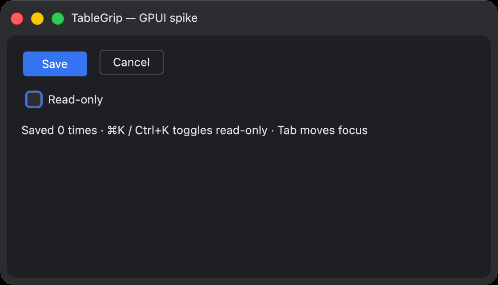

# Phase 0: baseline và spike, báo cáo

Kế hoạch tổng: [../rust-ui-kit.md](../rust-ui-kit.md). Kiểm kê cách app dùng Jewel: [inventory.md](inventory.md).

## Đã làm

| Phần | Ở đâu | Kết quả |
|---|---|---|
| Kiểm kê component | `docs/plans/rust-ui-kit/inventory.md` | Cách dùng, biến thể, trạng thái và test sẵn có của từng component. Chỉ đọc mã của TableGrip. |
| Bộ kịch bản dùng chung | `ui-kit/conformance/scenarios/*.json` | 19 kịch bản: checkbox (7), button (6), text field (6). |
| Runner Kotlin, chuẩn đối chiếu | `app/src/test/kotlin/dev/tablegrip/app/conformance/ConformanceTest.kt` | 19/19 pass trên component Jewel thật, cộng một test tự kiểm tra kỳ vọng sai. |
| Golden token và kích thước | `GoldenTest.kt` → `ui-kit/conformance/golden/*.json` | Graphite Dark, Graphite Light, One Dark: kích thước 12 mẫu, 32 màu mỗi theme. Chạy lại cho kết quả giống hệt. |
| Ảnh chuẩn | `ui-kit/conformance/reference/<theme>/gallery.png` | Render offscreen ở density 2. |
| Logic Rust | `ui-kit/crates/tg-ui-logic` | Checkbox, button, thứ tự focus. 13/13 kịch bản pass; 6 kịch bản text field để Phase 3. |
| Spike GPUI | `ui-kit/crates/tg-spike` | Cửa sổ có title bar tùy biến, font hệ thống, checkbox và button dùng `tg-ui-logic`, phím tắt qua keymap, 5 test headless pass. |
| CI | `.github/workflows/ui-kit.yml` | Rust trên macOS, Linux, Windows; Kotlin conformance và golden trên macOS. |

Chạy lại:

```bash
./gradlew :app:test --tests '*ConformanceTest*' --tests '*GoldenTest*'
```

```bash
cd ui-kit && cargo test --workspace
```

```bash
cd ui-kit && cargo run -p tg-spike
```

Ghi lại golden khi cố ý đổi giao diện bản Kotlin:

```bash
./gradlew :app:test --tests '*GoldenTest*' -Pconformance.record=true
```

## Kết quả spike



- **Màu khớp golden.** Ảnh chụp cửa sổ, sau khi chuyển về sRGB, cho nền island `#1E1F22` và nền frame `#2B2D30`
  trùng chính xác. Nút Save là `#3474F0` so với `#3574F0`, viền Cancel là `#4F5157` so với `#4E5157`: lệch 1 mức.
- **Hành vi đi qua dispatch thật của GPUI.** Click, Space, Enter, Tab và ⌘K đều được kiểm bằng `TestAppContext`,
  không cần màn hình.
- **Title bar tùy biến hoạt động trên macOS.** Traffic lights đặt được vị trí, nền liền màu frame.
- **Thời gian build:** khoảng 3 phút cho lần build sạch đầu tiên trên Apple Silicon. Các lần sau tính bằng giây.

## Quyết định đã chốt

**Chọn GPUI 0.2.2, có điều kiện.** Bằng chứng trên macOS đã đủ. Lựa chọn được chốt hẳn khi job CI Rust xanh trên
Linux và Windows. Danh sách thư viện Linux trong workflow chưa được chạy thử lần nào.
- **Icon:** tự vẽ, phát hành theo Apache‑2.0 cùng dự án; không dùng SVG của IntelliJ vì giấy phép không chứng minh
  được.
- **Toolchain:** ghim Rust 1.97.1.
- **Màu checkbox:** sửa để theo accent của theme (phát hiện 3).

## Phát hiện cần mang sang các phase sau

1. **Focus ring không được chiếm chỗ trong layout.** Trong spike, ring bọc ngoài làm nút Save lệch 2px so với Cancel.
   Bản Kotlin vẽ ring 2dp ra ngoài bounds (đo được ở golden: `textfield.focused.outline`). Phase 2 phải vẽ nó như lớp
   phủ.
2. **So ảnh phải chuyển về sRGB trước.** `screencapture` gắn profile màu của màn hình, làm màu bão hòa lệch (ví dụ
   `#3574F0` thành `#4573E8`). Công cụ so ảnh ở Phase 1 phải chuyển ICC về sRGB và dùng ngưỡng 1–2 mức.
3. **Đã sửa: checkbox (và radio) không theo accent của theme.** Trước đây ô được chọn luôn là xanh của Graphite
   (`#3574F0`), kể cả ở One Dark (accent `#4D78CC`) hay khi người dùng đặt `accentColor`. Nguyên nhân là icon SVG của
   Int UI vẽ sẵn màu đó. `TableGripTheme` giờ đổi màu qua bảng màu icon; golden One Dark đã ghi lại `#4D78CC`.
4. **Bàn phím cần hai pha.** App có 102 `onPreviewKeyEvent` và 13 `onKeyEvent`; phần lớn hành vi bàn phím là mã của
   app. Bản Rust cần pha preview (cha nhận trước) và pha bubble, không chỉ có action.
5. **Enter cũng bật/tắt checkbox,** không chỉ Space (đã kiểm trên Jewel). Hành vi này đã có trong kịch bản.
6. **Toolchain:** ghim Rust 1.97.1. Lần cài đầu bị treo vì chạy song song với một lần build khác; cài lại riêng thì
   bình thường.
7. **Giấy phép icon IntelliJ không rõ ràng.** Xem quyết định 2 trong [kế hoạch](../rust-ui-kit.md). Điều này cũng ảnh
   hưởng bản Kotlin đang phát hành: `bundledLicenses` trong `app/build.gradle.kts` đang ghi nhóm
   `com.jetbrains.intellij.platform` là Apache‑2.0. Cần rà lại.

## Còn mở

- CI Rust trên Linux và Windows chưa chạy lần nào: cần push để kiểm.
- Tab ở cuối danh sách, Shift+Tab và việc bỏ qua control bị disable chưa có kịch bản. Để dành cho Phase 2.
